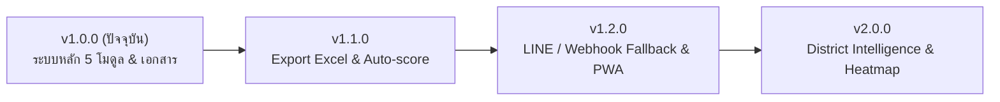

# SWPC Healthcare (ระบบบริหารจัดการงานเภสัชกรรมปฐมภูมิและงานคุ้มครองผู้บริโภคด้านสุขภาพ)

[](package.json)
[](https://nextjs.org/)
[](https://react.dev/)
[](https://tailwindcss.com/)
[](https://supabase.com/)
[](package-lock.json)

ระบบสารสนเทศเพื่อสนับสนุนงานเภสัชกรรมปฐมภูมิ (Primary Care Pharmacy) และงานคุ้มครองผู้บริโภคด้านสุขภาพ (Health Consumer Protection & RDU Community) เครือข่ายอำเภอสวรรคโลก จังหวัดสุโขทัย ครอบคลุมโรงพยาบาลสวรรคโลกและหน่วยบริการปฐมภูมิในเครือข่าย 19 รพ.สต./สอน./ศสม.

---

## 📌 สารบัญ (Table of Contents)
1. [ภาพรวมโมดูลหลักทั้ง 5 ส่วน](#-ภาพรวมโมดูลหลักทั้ง-5-ส่วน-core-modules)
2. [เทคโนโลยีและเครื่องมือ (Tech Stack)](#-เทคโนโลยีและเครื่องมือ-tech-stack)
3. [ขั้นตอนการติดตั้งและเริ่มต้นใช้งาน (Quick Start Guide)](#-ขั้นตอนการติดตั้งและเริ่มต้นใช้งาน-quick-start-guide)
4. [ลำดับการติดตั้งฐานข้อมูล Supabase (5 SQL Steps)](#-ลำดับการติดตั้งฐานข้อมูล-supabase-5-sql-steps)
5. [ข้อควรระวังสำคัญเชิงสถาปัตยกรรม (Architectural Guardrails)](#-ข้อควรระวังสำคัญเชิงสถาปัตยกรรม-architectural-guardrails)
6. [แผนพัฒนาต่อเนื่อง (Roadmap)](#-แผนพัฒนาต่อเนื่อง-roadmap)
7. [เอกสารอ้างอิงประจำโครงการ](#-เอกสารอ้างอิงประจำโครงการ)

---

## 🏥 ภาพรวมโมดูลหลักทั้ง 5 ส่วน (Core Modules)

ระบบในเวอร์ชัน **1.0.0** ประกอบด้วย 5 โมดูลหลักที่ทำงานร่วมกันอย่างสมบูรณ์:

| โมดูล | เส้นทาง (Route) | รายละเอียดและฟังก์ชันหลัก |
| :--- | :--- | :--- |
| **1. ระบบยืนยันตัวตนและจัดการผู้ใช้** | `/login`, `/register`, `/dashboard` | • ระบบสมัครสมาชิกและล็อกอินผ่าน Supabase Auth (`/login`, `/register`)<br>• ระบบอนุมัติผู้ใช้งาน 3 ระดับ: `pending`, `staff` (รพ.สต.), `pharmacist` (ผู้ดูแล)<br>• ระบบรีเซ็ตรหัสผ่านและเปลี่ยนสิทธิ์ผู้ใช้<br>• ระบบบริหารจัดการสถานพยาบาล (Hospitals/PCU CRUD) และกำหนดเภสัชกรผู้รับผิดชอบประจำ รพ.สต. บนหน้า `/dashboard` |
| **2. ระบบเกณฑ์มาตรฐานส่วนที่ 7** | `/criteria` | • เกณฑ์การประเมินงานเภสัชกรรมปฐมภูมิ 8 หมวด รวม 82 คะแนน<br>• ระบบคลังความรู้ (Knowledge Base) และแนวทางการดำเนินงาน<br>• เภสัชกรสามารถแก้ไขรายละเอียดเกณฑ์และคะแนนได้ตามระเบียบล่าสุด |
| **3. ระบบเฝ้าระวังความคลาดเคลื่อนทางยา** | `/me` | • รายงานและบันทึก Medication Errors (ME) ระดับความรุนแรง A–I ตามมาตรฐาน NCC MERP<br>• แยกบันทึกข้อผิดพลาดในขั้นตอน Prescribing, Transcribing, Dispensing, Administering<br>• มุมมองรายการอุบัติการณ์และส่งออกรายงานแบบพิมพ์มาตรฐาน A4 ผ่านโมดอลรายงาน (`MEPrintReport`) |
| **4. ระบบเฝ้าระวังผลิตภัณฑ์สุขภาพไม่ปลอดภัย** | `/unsafe-products` | • เฝ้าระวังยาชุด, สเตียรอยด์, สารเคมีปนเปื้อนในอาหาร และเครื่องสำอางอันตราย (G-RDU / ชุมชนใช้ยาปลอดภัย)<br>• บีบอัดรูปภาพหน้างานฝั่ง Client อัตโนมัติ (JPEG Web-friendly) ก่อนส่ง Supabase Storage<br>• วงจรจัดการความเสี่ยง 4 ระดับ: `pending` → `investigating` → `action_taken` → `resolved`<br>• บันทึกส่งต่อพิกัดร้านค้า/ร้านชำ, ลิงก์สำรองหลักฐานขึ้น Google Drive พร้อมรายงานแบบพิมพ์มาตรฐาน A4 (`UnsafeProductsPrintReport`) |
| **5. ระบบตรวจหลักฐานงานประเมิน** | `/evidence` | • ระบบส่งลิงก์โฟลเดอร์ Google Drive สำหรับตรวจเอกสารหลักฐานเกณฑ์ส่วนที่ 7 ทั้ง 8 หมวด<br>• สถาปัตยกรรมแยกข้อมูลราย รพ.สต. (Hospital Isolation) พร้อมตัวสลับดูรายหน่วยงานสำหรับเภสัชกร<br>• ระบบตรวจทาน (Review Workflow): `submitted` → `verified` / `needs_revision` พร้อมช่องทาง Comment<br>• หน้ารายงานสรุปผลการประเมินแบบกระดาษ A4 สำหรับพิมพ์ตรวจหน้างานราชการ (`EvidencePrintReport`) |

---

## 🛠 เทคโนโลยีและเครื่องมือ (Tech Stack)

- **Framework**: Next.js 15.5+ (App Router, Server Actions)
- **Language**: TypeScript 5+
- **Library & UI**: React 19, Tailwind CSS 3.4, Lucide React Icons
- **Backend & Database**: Supabase (PostgreSQL 15+, Supabase Auth, Row Level Security, Storage Buckets)
- **Package Manager**: `npm` 100% (Node.js >= 20.x LTS)
- **Print Layout**: Pure CSS `@media print` พร้อมครอบส่วนหน้าจอด้วย `.screen-only`

---

## 🚀 ขั้นตอนการติดตั้งและเริ่มต้นใช้งาน (Quick Start Guide)

### สิ่งที่ต้องเตรียม (Prerequisites)
- [Node.js](https://nodejs.org/) เวอร์ชัน 20.x ขึ้นไป (แนะนำ LTS ล่าสุด)
- บัญชีและโครงการ [Supabase](https://supabase.com/)

### ขั้นตอนติดตั้ง
1. **โคลนและเปิดโฟลเดอร์โปรเจกต์:**
   ```bash
   git clone <repository_url>
   cd SWPC
   ```

2. **ติดตั้ง Dependencies ด้วย npm:**
   ```bash
   npm install
   ```

3. **ตั้งค่า Environment Variables (`.env.local`):**
   คัดลอกไฟล์ต้นแบบและกรอกค่าจาก Supabase Project Settings:
   ```bash
   cp .env.example .env.local
   ```
   ระบุค่าใน `.env.local`:
   ```env
   NEXT_PUBLIC_SUPABASE_URL=https://your-project.supabase.co
   NEXT_PUBLIC_SUPABASE_ANON_KEY=your-anon-key-here
   ```

4. **รันเซิร์ฟเวอร์สำหรับทดสอบการพัฒนา:**
   ```bash
   npm run dev
   ```
   เปิดเบราว์เซอร์ไปที่: [http://localhost:3000](http://localhost:3000)

5. **ทดสอบ Build สำหรับ Production:**
   ```bash
   npm run build
   ```

---

## 🗄 ลำดับการติดตั้งฐานข้อมูล Supabase (5 SQL Steps)

เมื่อสร้างโปรเจกต์ Supabase ใหม่ หรือต้องการ Re-seed โครงสร้างฐานข้อมูล ให้รันไฟล์ SQL ใน Root ตามลำดับดังต่อไปนี้ผ่าน **Supabase Dashboard → SQL Editor**:

```
[1] database_schema.sql
     ↓
[2] fix_profiles_rls_and_trigger.sql
     ↓
[3] supabase_hospitals_and_admin_rpc.sql
     ↓
[4] supabase_unsafe_products_upgrade.sql
     ↓
[5] supabase_evidence_upgrade.sql
```

### คำอธิบายแต่ละสคริปต์:
1. **`database_schema.sql`**: สร้างตารางหลัก (`profiles`, `evaluation_criteria`, `medication_errors`, `unsafe_products`, `evidence_documents`) และตั้งค่า RLS พื้นฐาน
2. **`fix_profiles_rls_and_trigger.sql`**: แก้ปัญหา RLS Recursion ด้วยฟังก์ชัน `is_admin_or_pharmacist()` แบบ `SECURITY DEFINER` และสร้าง Trigger ซิงก์ผู้ใช้ใหม่จาก `auth.users` สู่ `profiles` อัตโนมัติ
3. **`supabase_hospitals_and_admin_rpc.sql`**: สร้างตาราง `hospitals`, กำหนด RLS, และสร้าง Stored Procedures สำหรับ Admin (จัดการ รพ.สต., เปลี่ยนสถานะ และรีเซ็ตรหัสผ่าน)
   > ⚠️ **ข้อควรระวังสำคัญ:** ห้ามเปลี่ยนชื่อหรือย้ายตำแหน่งไฟล์นี้ เนื่องจากมีโค้ดในระบบอ้างอิงชื่อไฟล์ตรงเพื่อแจ้งเตือน Admin ในกรณีฟังก์ชัน RPC ยังไม่ถูกรัน
4. **`supabase_unsafe_products_upgrade.sql`**: อัปเกรดตาราง `unsafe_products`, เพิ่ม Storage Bucket `unsafe-product-images`, และตั้งค่านโยบายความปลอดภัยการเข้าถึงรูปภาพ
5. **`supabase_evidence_upgrade.sql`**: อัปเกรดตาราง `evidence_documents` รองรับการเชื่อมโยง Google Drive Link, การคอมเมนต์ตรวจงานของเภสัชกร, และตาราง RLS ป้องกันข้าม รพ.สต.

> 💡 **ข้อแนะนำ:** หลังรันสคริปต์เสร็จ ให้รันคำสั่งด้านล่างนี้ 1 ครั้งใน SQL Editor เพื่อเคลียร์ Schema Cache ของ PostgREST:
> ```sql
> NOTIFY pgrst, 'reload schema';
> ```

---

## 🛡 ข้อควรระวังสำคัญเชิงสถาปัตยกรรม (Architectural Guardrails)

1. **การป้องกัน Loop ใน RLS:** ห้ามเขียน Subquery ที่ Query ไปยังตาราง `profiles` โดยตรงใน Policy ของ `profiles` ให้เรียกผ่านฟังก์ชัน `is_admin_or_pharmacist()` เท่านั้น
2. **ระบบการพิมพ์เอกสารราชการ (Print Layout):** ส่วนของหน้าเว็บที่แสดงผลบนจอ ต้องห่อด้วย `.screen-only` และเอกสาร A4 สำหรับพิมพ์ต้องใช้ `@media print` พร้อมคุมระยะขอบ Margin ให้คงที่
3. **การจัดการพื้นที่จัดเก็บไฟล์ (Zero-Quota Bloat):**
   - รูปภาพสำรวจหน้างาน (ยาชุด/สเตียรอยด์): ย่อขนาดภาพบนเบราว์เซอร์ก่อนส่งเข้า Supabase Storage (เก็บเฉพาะไฟล์จำเป็น)
   - ไฟล์เอกสารตรวจราชการขนาดใหญ่ (PDF/Word): ใช้สถาปัตยกรรมเชื่อมโยง Google Drive Folder Link เพื่อไม่ให้เปลืองโควตา Storage ฟรี 1 GB ของ Supabase

---

## 🗺 แผนพัฒนาต่อเนื่อง (Roadmap)



- **v1.0.0 (Baseline ปัจจุบัน)**: ความสมบูรณ์ของระบบ 5 โมดูลหลัก, ระบบพิมพ์ A4, มาตรฐาน npm 100%, และเอกสาร 4 เสาหลัก
- **v1.1.0 (Data Engine)**:
  - ส่งออกข้อมูล Medication Errors เป็นไฟล์ Excel (.xlsx) และ CSV จำแนกความรุนแรง A–I
  - ส่งออกทะเบียนผลิตภัณฑ์สุขภาพไม่ปลอดภัยและประวัติร้านค้าชุมชน
  - ระบบรวมคะแนนอัตโนมัติ 82 คะแนน จากสถานะ `verified` ในระบบตรวจหลักฐาน
- **v1.2.0 (Community Alerts & Mobile PWA)**:
  - ระบบแจ้งเตือนอุบัติการณ์ฉุกเฉิน (ME ระดับ E–I และการตรวจพบสเตียรอยด์)
  - **สถาปัตยกรรมการแจ้งเตือน (Hybrid Notification Architecture)**:
    - ช่องทางหลัก: **LINE Messaging API** สำหรับแจ้งเตือนกลุ่มเภสัชกรเครือข่าย
    - ช่องทางสำรองอัตโนมัติ (Fallback / Alternative): **Discord Webhook / Telegram Webhook** เพื่อป้องกันปัญหาข้อจำกัดโควตาฟรีของ LINE (โควตา 200 ข้อความ/เดือน)
- **v2.0.0 (District Intelligence)**:
  - แดชบอร์ดสรุปผลงานระดับอำเภอ เปรียบเทียบ 19 รพ.สต. (Performance Heatmap)

---

## 📚 เอกสารอ้างอิงประจำโครงการ

- [CHANGELOG.md](file:///c:/SWPC/CHANGELOG.md) - บันทึกประวัติการเปลี่ยนแปลงและการปล่อยเวอร์ชัน
- [DEVLOG.md](file:///c:/SWPC/DEVLOG.md) - บันทึกข้อควรระวังเชิงเทคนิค (Gotchas), จุดผิดพลาดที่พบบ่อย และการแก้ปัญหา
- [HANDOFF.md](file:///c:/SWPC/HANDOFF.md) - เอกสารสรุปบริบทโครงการสำหรับการส่งต่องานระหว่าง AI หรือผู้พัฒนาท่านอื่น
